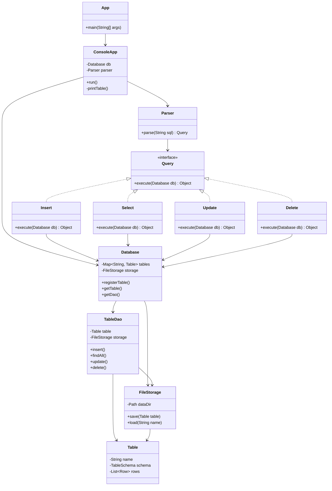
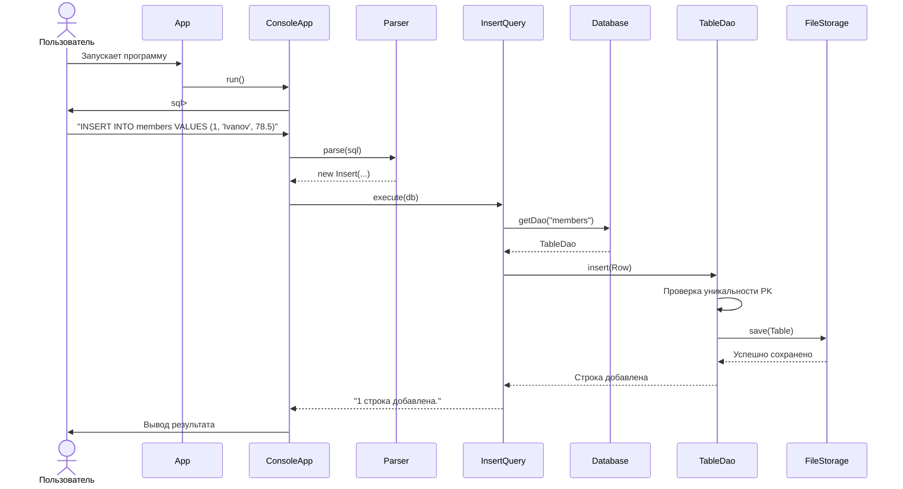

# Лабораторная работа 2: Разработка упрощённой СУБД на Java

## Предметная область: Фитнес-клуб
Система управляет двумя связанными таблицами: `members` (клиенты клуба) и `visits` (посещения). Связь реализована через внешний ключ (`visits.member_id -> members.id`).

## Архитектура системы
Программа разделена на слои (паттерны DAO, Command):
*   **entity** — модель данных (`Table`, `Row`, `Column`, `TableSchema`, `DataType`). Все классы реализуют `Serializable`.
*   **storage** — сохранение данных на диск (`FileStorage`). Использует Java-сериализацию.
*   **dao** — слой доступа к данным (`BaseDao`, `TableDao`, `Database`). Проверяет уникальность PK и сохраняет изменения.
*   **sql** — парсер SQL-запросов (`Parser`, `Condition`).
*   **command** — реализации команд (`Insert`, `Select`, `Update`, `Delete`).
*   **console** — консольный интерфейс для ввода команд.

### Диаграмма классов


## Диаграмма последовательностей

### Схема базы данных
**Таблица `members` (Клиенты):**
*   `id` (INT) — первичный ключ (PK).
*   `name` (STRING) — имя.
*   `weight` (DOUBLE) — вес.

**Таблица `visits` (Посещения):**
*   `id` (INT) — первичный ключ (PK).
*   `member_id` (INT) — внешний ключ (FK), ссылается на `members.id`.
*   `duration` (INT) — длительность занятия в минутах.

## Инструкция пользователя (Как запустить)

1. Откройте проект в VS Code (или любой IDE).
2. Запустите файл `src/App.java`.
3. В консоли появится приглашение `sql> `.
4. Введите SQL-подобную команду и нажмите Enter.
5. Для выхода введите `exit`.

### Примеры команд для проверки:
```sql
-- Вставка с указанием всех полей
INSERT INTO members VALUES (1, 'Ivanov', 78.5);

-- Вставка с указанием конкретных полей (остальные будут null)
INSERT INTO members (id, name) VALUES (2, 'Petrova');

-- Выборка всех записей
SELECT * FROM members;

-- Выборка с условием (WHERE)
SELECT name, weight FROM members WHERE weight > 70;

-- Обновление (UPDATE)
UPDATE members SET weight = 80.0 WHERE id = 2;

-- Удаление (DELETE)
DELETE FROM members WHERE name = 'Ivanov';
```

### Выводы
В ходе работы была разработана упрощённая СУБД на Java. Реализована сериализация таблиц в файлы, поддержка пяти типов данных, парсинг SQL-подобного языка (INSERT, SELECT, UPDATE, DELETE) и консольный интерфейс. Применены паттерны проектирования (DAO, Command, Iterator). Ограничения: нет поддержки транзакций, сложных JOIN-запросов и индексов.